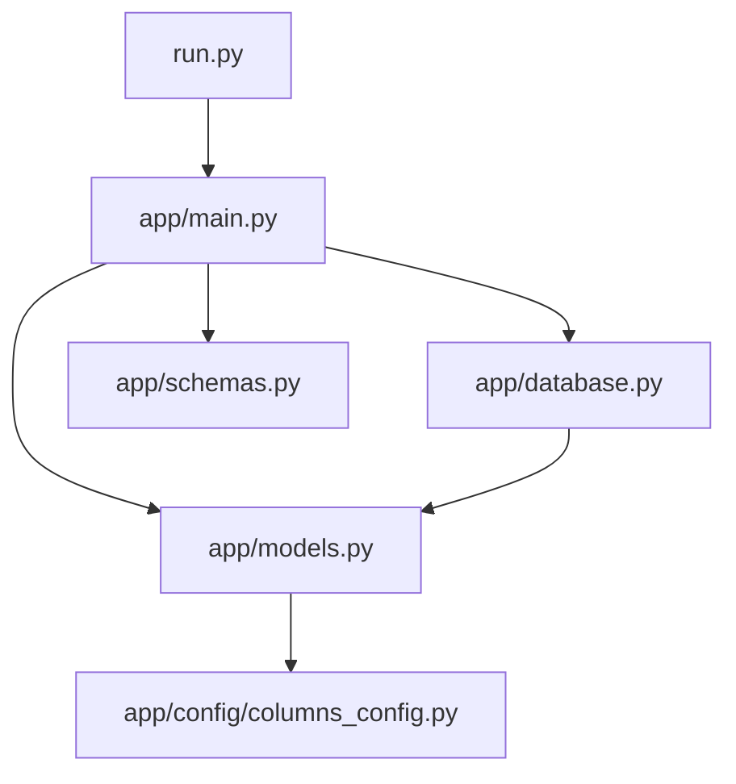

# Backend - Sistema de Ensayos Especiales (SIGEG)

Este directorio contiene los servicios API desarrollados con FastAPI que permiten interactuar con la base de datos (SQL Server / SQLite) y procesar importaciones/exportaciones de hojas de cálculo de ensayos geotécnicos especiales.

## Estructura y Roles de los Archivos

*   `run.py`: Punto de entrada del backend. Inicia el servidor de desarrollo Uvicorn en el puerto `8002` y ejecuta de forma automática las migraciones de base de datos para asegurar que la tabla `registro_maestro` esté alineada al 100% con la estructura declarada.
*   `requirements.txt`: Lista de dependencias del sistema de Python (FastAPI, SQLAlchemy, PyMSSQL, PyODBC, openpyxl, etc.).
*   `.env`: Configuración del puerto del servidor, dirección de base de datos SQL Server y variables de entorno del sistema.
*   `app/database.py`: Manejador de conexiones y pools de base de datos. Detecta automáticamente si está disponible SQL Server local (utilizando credenciales integradas Trusted_Connection) y, si no está disponible o falla, realiza un fallback transparente a una base de datos local SQLite `app/ensayos_especiales.db` para desarrollo offline sin interrupciones.
*   `app/models.py`: Declaración única del modelo ORM de SQLAlchemy. Contiene la definición de la tabla `registro_maestro` con sus 47 columnas mapeadas uno a uno con el Excel original para garantizar que no haya pérdida de datos.
*   `app/schemas.py`: Clases de Pydantic v2 para la validación y serialización de datos de entrada/salida (CRUD e importaciones).
*   `app/main.py`: Endpoints REST principales del sistema. Proporciona:
    *   Endpoints CRUD para consultar y modificar registros de la grilla.
    *   Endpoint `/api/import-excel` para procesar la subida del Excel, parsear dinámicamente según la configuración de columnas y guardar en base de datos.
    *   Endpoint `/api/export-excel` para generar la descarga del archivo Excel de acuerdo a los filtros aplicados.
*   `app/config/columns_config.py`: Configuración declarativa centralizada del backend. Contiene los metadatos de las 47 columnas (ID, tipo de dato, nombre de columna de BD y fórmula de base) para guiar la creación de esquemas y migraciones de forma unificada.

## Relaciones

