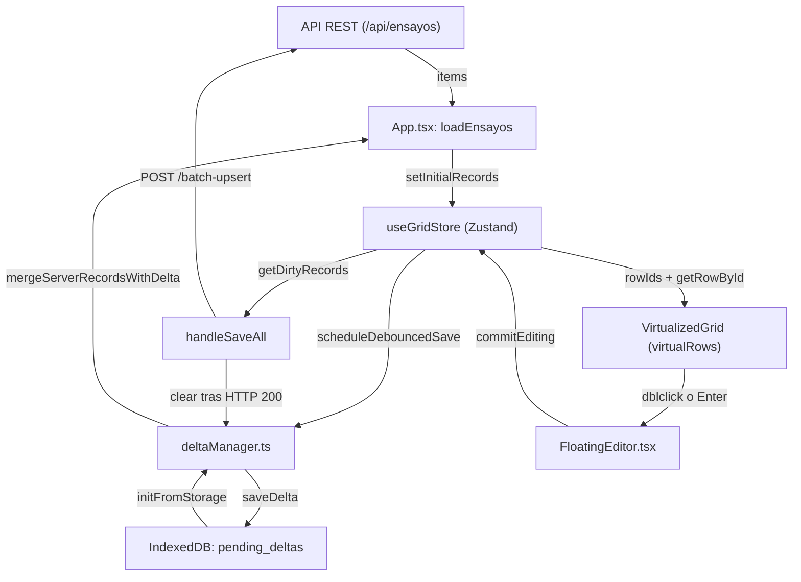

# VirtualizedGrid (v2) - Documentación Técnica

Documentación técnica del componente de grilla virtualizada de Ensayos Especiales (`frontend/src/features/grid/`).

---

## 1. Activación y Flags de Versión

La selección de la versión de la grilla está centralizada en [`frontend/src/features/grid/flags.ts`](file:///c:/Users/DrN/UNSA/TRABAJO/GEMA/Ensayos_Especiales/Sistema/frontend/src/features/grid/flags.ts):

* **Función `getGridVersion()`:** Determina si se monta la grilla clásica (`v1`) o la grilla virtualizada (`v2`).
* **Resolución por prioridades:**
  1. Parámetro en la URL: `?grid=v1` o `?grid=v2` (evaluado con `window.location.search`).
  2. Almacenamiento local: `localStorage.getItem('sigeg_grid_version')`.
  3. Valor predeterminado: `'v2'` (si no hay parámetro ni clave en localStorage).
* **Función `setGridVersion(version)`:** Guarda la preferencia `'v1'` o `'v2'` en `localStorage` bajo la clave `'sigeg_grid_version'`.
* **Aislamiento:** La grilla `v1` reside en componentes tradicionales (`GeotechPage.tsx`). Si `isV2 === false`, la vista monta el renderizado original sin interactuar con el store de Zustand ni con IndexedDB.

---

## 2. Mapa de Carpetas y Archivos

### `frontend/src/features/grid/`
* `VirtualizedGrid.tsx`: Componente contenedor principal. Maneja la virtualización de filas con `@tanstack/react-virtual`, el montaje de cabeceras con `@tanstack/react-table`, navegación con flechas de teclado, tooltip delegado y barra de paginación inferior.
* `FloatingEditor.tsx`: Input o selector flotante posicionado de forma absoluta sobre la celda activa, con validación reactiva en tiempo real contra el esquema de columnas.
* `gridStore.ts`: Store global en Zustand (`useGridStore`). Mantiene registros normalizados por `idd` en `Map<number, Record<string, any>>`, snapshots originales (`originalRecordsById`), seguimiento de modificaciones (`dirtyRowIds`), eliminaciones (`deletedRowIds`), alertas QA/QC (`qaqcAlertsByRowId`) y operaciones de descarte.
* `columnsDefinition.ts`: Transforma las definiciones de `ColumnSchema` a `GridColumnDef` consumibles por `VirtualizedGrid` (`schemaToGridColumnDef` y `getGridColumnsForModule`).
* `flags.ts`: Lógica de resolución de versión (`getGridVersion` y `setGridVersion`).
* `types.ts`: Tipos TypeScript de coordenadas de celda (`CellCoordinate`), editor flotante (`FloatingEditorPosition`) y definición de columnas de la grilla (`GridColumnDef`).
* `__tests__/`: Pruebas unitarias de columnas, store, dirty tracking, bloqueo de celdas convertibles y persistencia local.

### `frontend/src/features/grid/schema/`
* `types.ts`: Interfaces nucleares (`ColumnSchema`, `ColumnDataType`, `EmptyPolicy`, `QAQCAlert`, `ColumnConstraints`) y definición de `GLOBAL_EMPTY_TOKENS: readonly string[] = ['-', '--']`.
* `columns.ts`: Catálogo declarativo Single Source of Truth (SSOT). Lista las 50 columnas del sistema (48 de datos geomecánicos + 2 de control en interfaz: `qaqc_validacion` y `acciones_col`), exportando `COLUMNS_SCHEMA` y `COLUMNS_SCHEMA_MAP`.
* `columnFactories.ts`: Factorías tipadas para construir columnas (`textColumn`, `decimalColumn`, `integerColumn`, `selectColumn`, `calculatedColumn`, `actionColumn`).
* `convertiblePairs.ts`: Definición de pares convertibles bidireccionales ($kg/cm^2 \leftrightarrow MPa$), fórmulas de cálculo y la función `isConvertibleFieldReadOnly`.
* `validationEngine.ts`: Motor de evaluación que valida celdas individuales (`validateCell`) y filas combinadas (`validateRowCombined`) contra restricciones físicas y políticas de vacíos.
* `dependencyRules.ts`: Reglas de dependencia entre columnas (`DEPENDENCY_RULES`) y configuración de tolerancia UCS (`UCS_TOLERANCE_CONFIG`).
* `tableValidators.ts`: Validaciones a nivel de conjunto de datos (Desde vs Hasta, solapes de intervalos y códigos duplicados).
* `index.ts`: Re-exportación del módulo y función `getSchemaColumnsForModule` para filtrar columnas por módulo geomecánico.

### `frontend/src/features/grid/storage/`
* `types.ts`: Interfaces de persistencia (`GridDelta`, `ModifiedRowDelta`, `RowConflict`).
* `indexedDbDeltaStore.ts`: Capa de acceso a la base de datos `sigeg_local_store` de IndexedDB (object store `pending_deltas`, clave `current_delta`).
* `deltaManager.ts`: Gestor con debounce de 500 ms que extrae el delta de cambios del store de Zustand y reconcilia con datos del servidor.

---

## 3. Flujo de Datos

1. **Carga desde el Backend:** `App.tsx` ejecuta `loadEnsayos(page, pageSize, query, tab)`. La API responde con `data.items`.
2. **Reconciliación Local:** `deltaManager.initFromStorage()` lee el delta pendiente de IndexedDB. `deltaManager.mergeServerRecordsWithDelta(loadedItems)` aplica las modificaciones no guardadas sobre las filas del servidor.
3. **Poblado del Store:** `useGridStore.getState().setInitialRecords(mergeResult.merged, { originalRecords: loadedItems })` normaliza los registros en mapas `recordsById` y `originalRecordsById`.
4. **Renderizado Virtual:** `VirtualizedGrid.tsx` consulta `rowIds`. `@tanstack/react-virtual` determina los índices de filas que caben en el viewport (`virtualRows`). Cada fila se dibuja con el componente memoizado `GridRow`.
5. **Edición:** Al pulsar doble clic o Enter sobre una celda editable, se abre `FloatingEditor.tsx`. Al confirmar con Enter o desenfocar (`onBlur`):
   * Se ejecuta `commitEditing()`.
   * Se compara el valor editado contra `originalRecordsById`. Si difiere, el `rowId` se añade a `dirtyRowIds`. Si vuelve al valor original, se elimina de `dirtyRowIds` (smart revert).
   * Se recalculan campos derivados de la fila y se ejecuta `validateRowCombined()` actualizando `qaqcAlertsByRowId` de forma incremental.
   * Se programa `deltaManager.scheduleDebouncedSave(get())`, que tras 500 ms escribe el delta en IndexedDB.
6. **Guardado:** Al presionar "Guardar Cambios", `handleSaveAll()` envía las eliminaciones a `/api/ensayos/batch-delete` y los registros dirty en lotes de 500 a `/api/ensayos/batch-upsert`. Tras recibir HTTP 200, limpia `dirtyRowIds`, invoca `deltaManager.clear()` y vuelve al estado `synced`.

---

## 4. Esquema de Columnas

El archivo [`columns.ts`](file:///c:/Users/DrN/UNSA/TRABAJO/GEMA/Ensayos_Especiales/Sistema/frontend/src/features/grid/schema/columns.ts) exporta `COLUMNS_SCHEMA` con 50 definiciones de columna.

### Propiedades de `ColumnSchema`
| Propiedad | Tipo | Efecto |
| :--- | :--- | :--- |
| `id` | `string` | Nombre del campo en el modelo y base de datos. |
| `header` | `string` | Etiqueta visible en la cabecera de la tabla. |
| `excelName` | `string` | Nombre de cabecera para importación y exportación Excel. |
| `group` | `string` | Título del grupo en el nivel superior de cabecera. |
| `module` | `string` | Módulo geomecánico de pertenencia (`common`, `ucs`, `elasticas`, `traccion`, `corte`, `triaxial`, `propiedades`). |
| `visibleIn` | `string[]` | Módulos específicos donde la columna debe mostrarse (opcional; prevalece sobre `module`). |
| `defaultWidth` | `number` | Ancho inicial en píxeles. |
| `minWidth` / `maxWidth` | `number` | Límites aplicados durante el redimensionamiento manual. |
| `pinned` | `'left' \| 'right' \| undefined` | Fija la columna a la izquierda o derecha de la grilla. |
| `editor` | `'text' \| 'select' \| 'none'` | Tipo de control a renderizar en `FloatingEditor.tsx`. |
| `emptyPolicy` | `'allowed' \| 'warn' \| 'block'` | Comportamiento cuando la celda está vacía. |
| `constraints` | `ColumnConstraints` | Restricciones numéricas: `minHard`, `maxHard`, `minSoft`, `maxSoft`, `positiveOnly`. |
| `decimals` | `number` | Precisión decimal visual (no altera el valor original en datos). |
| `unit` | `string` | Unidad de medida mostrada entre paréntesis en la cabecera. |
| `hint` / `displayHint` | `string` | Mensajes descriptivos desplegados en el tooltip delegado. |

### Columnas de Observación
* **`traccion_observaciones`:** Identificador: `traccion_observaciones`, cabecera `'Observaciones TI'`, grupo `'Tracción Indirecta'`. Corresponde al campo `traccion_observaciones = Column(String(500))` en [`backend/app/models.py`](file:///c:/Users/DrN/UNSA/TRABAJO/GEMA/Ensayos_Especiales/Sistema/backend/app/models.py#L50).
* **`observacion`:** Identificador: `observacion`, cabecera `'Observaciones'`, grupo `'Validación y Cierre'`. Corresponde a `observacion = Column(String(500))` en `backend/app/models.py`.

---

## 5. Motor de Validación

Implementado en [`validationEngine.ts`](file:///c:/Users/DrN/UNSA/TRABAJO/GEMA/Ensayos_Especiales/Sistema/frontend/src/features/grid/schema/validationEngine.ts):

1. **Tokens de Vacío:** Definidos en `schema/types.ts` como `GLOBAL_EMPTY_TOKENS: readonly string[] = ['-', '--']`. Si el contenido coincide con estos tokens o es `null`/`undefined`/`''`, se evalúa mediante `emptyPolicy`:
   * `'allowed'`: No genera alerta.
   * `'warn'`: Genera alerta de severidad `AVISO`.
   * `'block'`: Genera alerta de severidad `CRÍTICO`.
2. **Límites Físicos:**
   * `positiveOnly`: Si el valor es $\le 0$, genera alerta `CRÍTICO` ("Debe ser un valor positivo").
   * `minHard` / `maxHard`: Si el valor queda fuera del intervalo, genera alerta `CRÍTICO`.
   * `minSoft` / `maxSoft`: Si el valor queda fuera del intervalo recomendado pero dentro de los límites duros, genera alerta `AVISO`.
3. **Reglas de Dependencia:**
   * En [`dependencyRules.ts`](file:///c:/Users/DrN/UNSA/TRABAJO/GEMA/Ensayos_Especiales/Sistema/frontend/src/features/grid/schema/dependencyRules.ts):
     - `corte_directo_requires_tipo_fractura`: Posee `enabled: false`.
     - `UCS_TOLERANCE_CONFIG`: Regla de discrepancia del 1% entre `ucs_resistencia` y `ucs_resistencia_calculada`. Posee `enabled: false`.
     - `PARTIAL_TEST_DEPENDENCY_RULES`: Arreglo vacío `[]`.
4. **Validadores de Tabla:**
   * En [`tableValidators.ts`](file:///c:/Users/DrN/UNSA/TRABAJO/GEMA/Ensayos_Especiales/Sistema/frontend/src/features/grid/schema/tableValidators.ts):
     - `validateDesdeHasta`: Comprueba que `desde < hasta`.
     - `validateIntervalOverlaps`: Detecta solapes de intervalos para un mismo sondaje.
     - `validateDuplicateSampleCodes`: Detecta códigos de muestra duplicados.

---

## 6. Campos Calculados y Pares Convertibles

Ubicados en [`convertiblePairs.ts`](file:///c:/Users/DrN/UNSA/TRABAJO/GEMA/Ensayos_Especiales/Sistema/frontend/src/features/grid/schema/convertiblePairs.ts):

* **Par Soportado:** Tracción indirecta entre $kg/cm^2$ (`traccion_resistencia_kgcm2`) y $MPa$ (`traccion_resistencia_mpa`).
* **Fórmulas de Conversión:**
  * De $kg/cm^2$ a $MPa$: $\text{valor} \times 0.0980665$, redondeado a 2 decimales.
  * De $MPa$ a $kg/cm^2$: $\text{valor} / 0.0980665$, redondeado a 2 decimales.
* **Bloqueo de Edición (`isConvertibleFieldReadOnly`):**
  * Si ambos campos tienen datos (filas históricas): **Ambos editables**. Al editar uno, el otro se recalcula.
  * Si solo uno de los campos tiene valor: El campo vacío se bloquea para evitar inconsistencias directas.
  * Si el usuario borra la celda de origen: Ambas celdas quedan vacías y ambas se desbloquean.
* **Apariencia en Grilla:** La celda bloqueada recibe fondo atenuado (`bg-slate-900/60`), cursor `not-allowed`, y al seleccionarla o hacer doble clic despliega un mensaje explicativo: *"Calculado automáticamente. Para modificarlo, edita o limpia su celda equivalente"*.

---

## 7. Store y Gestión de Estado

Ubicado en [`gridStore.ts`](file:///c:/Users/DrN/UNSA/TRABAJO/GEMA/Ensayos_Especiales/Sistema/frontend/src/features/grid/gridStore.ts):

* **Estructura Normalizada:**
  * `recordsById`: `Map<number, Record<string, any>>` con los registros actuales en memoria.
  * `originalRecordsById`: `Map<number, Record<string, any>>` con el snapshot original traído del servidor.
  * `rowIds`: Arreglo de números que determina el orden y cantidad de filas.
  * `rowVersions`: `Map<number, number>` para invalidar selectivamente filas en React sin re-renderizar la grilla entera.
* **Dirty Tracking y Smart Revert:**
  * Al editar, si `isRecordDifferent(row, original)` es verdadero, el `rowId` se añade a `dirtyRowIds`.
  * Si el usuario restaura el valor que tenía el snapshot original, el `rowId` se remueve automáticamente de `dirtyRowIds`.
* **Notificación Incremental:** La revalidación tras editar se ejecuta en $O(1)$ sobre la fila modificada mediante `validateRowCombined(row)`, actualizando únicamente la entrada de esa fila en `qaqcAlertsByRowId`.

---

## 8. Renderizado y Arquitectura de la Grilla

Implementado en [`VirtualizedGrid.tsx`](file:///c:/Users/DrN/UNSA/TRABAJO/GEMA/Ensayos_Especiales/Sistema/frontend/src/features/grid/VirtualizedGrid.tsx):

* **Virtualización:** `@tanstack/react-virtual` con `estimateSize: () => 36` y `overscan: 10`. Solo los elementos visibles en el scroll se encuentran presentes en el DOM.
* **Layout:** Etiqueta `<table>` nativa con `table-layout: fixed`.
* **Colgroup:** Elementos `<col id="grid-col-${col.id}">` en el `<colgroup>` gobiernan los anchos de columnas de forma nativa por el motor del navegador.
* **Filas Espaciadoras:** `virtualPaddingTop` y `virtualPaddingBottom` mantienen la altura total calculada del contenedor (`totalVirtualSize`).
* **Columnas Fijas (Sticky):**
  * Columnas fijas a la izquierda (`idd`, `sondaje`, `codigo_muestra`): `sticky left-0`, con offset acumulado (`stickyOffset`).
  * Columnas fijas a la derecha (`qaqc_validacion`, `acciones_col`): `sticky right-0`, con offset acumulado (`stickyRightOffset`).
* **Cabecera de 2 Niveles (`GridHeader`):** Memoizada con `React.memo` para no re-renderizar al mover la celda activa. Fila superior para grupos (`h-7`) y fila inferior para columnas hoja (`h-8.5`).
* **Redimensionamiento:** `handleStartResize` captura el puntero (`setPointerCapture`) y manipula directamente el estilo `style.width` de los elementos `<col>` y `<th>` en el DOM sin disparar re-renders de React durante el arrastre. El commit definitivo se persiste al soltar el ratón (`onPointerUp`).
* **Editor Flotante (`FloatingEditor.tsx`):** Un contenedor posicionado absolutamente sobre la celda activa mediante `top`, `left`, `width` y `height`. Contiene validación en caliente y maneja eventos `Enter`, `Tab`, `Escape` y `onBlur`.
* **Tooltip Delegado:** Un único evento `onPointerOver` en el contenedor de la grilla detecta el elemento `td[data-col-key]` más cercano y posiciona un elemento `div` flotante fijo, eliminando miles de atributos `title` del árbol DOM.

---

## 9. Guardado y Sincronización

* **Lotes de Envío:** En [`App.tsx`](file:///c:/Users/DrN/UNSA/TRABAJO/GEMA/Ensayos_Especiales/Sistema/frontend/src/App.tsx), los registros modificados obtenidos con `useGridStore.getState().getDirtyRecords()` se particionan en bloques de 500 filas (`chunkSize = 500`) y se envían a `POST /api/ensayos/batch-upsert`.
* **Eliminaciones:** Se envían como un arreglo numérico de identificadores a `POST /api/ensayos/batch-delete`.
* **Política de Bloqueo:** Si existen alertas de severidad `CRÍTICO` en el conjunto, el guardado se interrumpe y se presenta el modal de alerta (`SaveBlockingModal`).
* **Colisiones de IDD:** Si al importar datos existen IDs duplicados con registros locales, se abre `IdCollisionModal` para permitir reasignar identificadores o descartar duplicados.

---

## 10. Limitaciones y Pendientes

1. **Pegado Multi-Celda:** No está implementado el parseo de portapapeles para pegar bloques tabulares procedentes de Excel sobre un rango de celdas.
2. **Undo / Redo Histórico:** No existe pila de deshacer/rehacer multi-nivel con `Ctrl+Z` / `Ctrl+Y` (únicamente reversión de celda por smart revert o descarte global con el botón "Descartar cambios").
3. **Reglas Desactivadas:** La regla de discrepancia de 1% de UCS y la regla de fractura en corte directo permanecen en código con bandera `enabled: false`.
