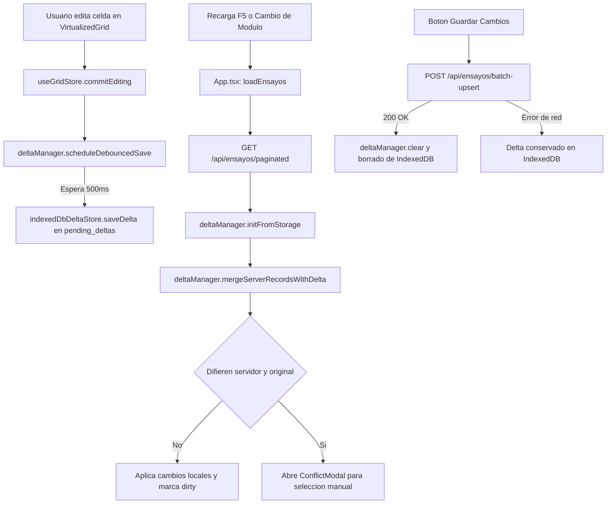

# Persistencia Local de Cambios y Descarte

Documentación técnica del sistema de almacenamiento temporal offline y reversión de cambios no sincronizados en `VirtualizedGrid` (v2).

---

## 1. Problema que Resuelve

Al interactuar con la grilla de ensayos, los cambios de edición, inserción y eliminación residían únicamente en el estado volátil de React o se sobreescribían al navegar entre módulos y recargar la página (`F5`). La persistencia local desacopla la edición en memoria del servidor guardando un delta incremental en IndexedDB, permitiendo recuperar el trabajo tras desconexiones, recargas o cambios de pestaña sin enviar datos prematuros a la base de datos remota, y proveyendo un mecanismo explícito para descartar los cambios pendientes en cualquier momento.

---

## 2. Qué se Guarda

### 2.1 Formato Exacto del Delta

El almacenamiento se gestiona a través de la interfaz `GridDelta` definida en [`frontend/src/features/grid/storage/types.ts`](file:///c:/Users/DrN/UNSA/TRABAJO/GEMA/Ensayos_Especiales/Sistema/frontend/src/features/grid/storage/types.ts):

```typescript
export interface ModifiedRowDelta {
  current: Record<string, any>;
  original: Record<string, any>;
  updatedAt: number;
}

export interface GridDelta {
  version: number;
  timestamp: number;
  modifiedRows: Record<number, ModifiedRowDelta>;
  insertedRows: Record<string, any>[];
  deletedRowIds: number[];
}

export interface RowConflict {
  idd: number;
  sondaje?: string;
  field: string;
  serverValue: any;
  localValue: any;
  originalValue: any;
  serverRecord: Record<string, any>;
  localRecord: Record<string, any>;
  originalRecord: Record<string, any>;
}
```

### 2.2 Delta vs. Tabla Completa y Tamaño Medido

La tabla `registro_maestro` contiene un catálogo extenso de registros con 50 columnas. Serializar la tabla completa en cada pulsación o edición provocaría bloqueos de hilo y consumo innecesario de almacenamiento.

El delta registra únicamente los registros afectados y sus snapshots originales (`current` y `original`). Medición real:
* Cada registro modificado almacena tanto el objeto `current` como `original` (50 columnas cada uno).
* El tamaño medido en formato JSON serializado es de aproximadamente **3.2 KB por fila modificada** (ej. ~32 KB para un conjunto de 10 filas editadas).

### 2.3 Ubicación en IndexedDB

Implementado en [`frontend/src/features/grid/storage/indexedDbDeltaStore.ts`](file:///c:/Users/DrN/UNSA/TRABAJO/GEMA/Ensayos_Especiales/Sistema/frontend/src/features/grid/storage/indexedDbDeltaStore.ts):

| Parámetro | Valor |
| :--- | :--- |
| **Nombre de Base de Datos** | `sigeg_local_store` |
| **Versión de Base de Datos** | `1` |
| **Object Store** | `pending_deltas` |
| **Clave Única** | `current_delta` |
| **Versión del Esquema** | `CURRENT_DELTA_SCHEMA_VERSION = 1` |

### 2.4 Control de Corrupción y Versionado

La función `isDeltaCorrupted(data: any): boolean` verifica que la estructura cumpla:
- Ser un objeto no nulo.
- Tener `version === 1`.
- Poseer `timestamp` numérico.
- Poseer `modifiedRows` de tipo objeto.
- Poseer `insertedRows` y `deletedRowIds` de tipo `Array`.

Si `loadDelta()` detecta que el objeto almacenado no cumple con la versión o estructura esperada, emite un aviso a la consola, ejecuta `clearDelta()` de forma transparente y retorna `null`, permitiendo que la aplicación continúe con los datos limpios del servidor sin romperse.

---

## 3. Ciclo de Vida Paso a Paso



### 3.1 Edición de Celda
1. El usuario modifica un valor en el editor y pulsa Enter o desenfoca la celda.
2. `commitEditing()` en [`frontend/src/features/grid/gridStore.ts`](file:///c:/Users/DrN/UNSA/TRABAJO/GEMA/Ensayos_Especiales/Sistema/frontend/src/features/grid/gridStore.ts) actualiza la memoria reactiva del store, recalcula campos derivados y actualiza `dirtyRowIds`.
3. Inmediatamente invoca `deltaManager.scheduleDebouncedSave(storeState)`.
4. El gestor programa un temporizador de 500 ms. Si el usuario continúa escribiendo, el temporizador anterior se cancela y se reinicia.
5. Al cumplirse los 500 ms sin nuevas interacciones, el hilo secundario escribe el delta en `sigeg_local_store` de IndexedDB, fuera del ciclo crítico de renderizado del grid.

### 3.2 Cambio de Módulo o Recarga (`F5`)
1. Antes de desmontar la vista o cambiar de pestaña en el menú lateral, `navigateToTab` en [`frontend/src/App.tsx`](file:///c:/Users/DrN/UNSA/TRABAJO/GEMA/Ensayos_Especiales/Sistema/frontend/src/App.tsx) invoca `deltaManager.flushImmediate(useGridStore.getState())` para consolidar escrituras pendientes de forma síncrona en memoria y asíncrona en IndexedDB.
2. El listener global `beforeunload` intercepta el cierre de la ventana, ejecuta `flushImmediate` y activa el diálogo nativo del navegador si existen cambios pendientes.
3. Al recargar la página o ingresar a otro módulo:
   - Se realiza la petición HTTP al servidor (`loadEnsayos`).
   - Se ejecuta `await deltaManager.initFromStorage()` para recuperar el delta persistido.
   - `deltaManager.mergeServerRecordsWithDelta(loadedItems)` cruza los registros del servidor con las modificaciones locales pendientes.
   - Se llama a `useGridStore.getState().setInitialRecords(mergeResult.merged, { originalRecords: loadedItems })`, manteniendo el snapshot base del servidor para smart revert.
   - Si existen cambios recuperados, se notifica al usuario: `"Se recuperaron N cambios sin guardar"` y el indicador superior cambia a `"Sin guardar"`.

### 3.3 Navegación Entre Páginas del Grid
1. El delta en memoria (`pendingDelta`) almacena modificaciones indexadas por el identificador global `idd`.
2. Al paginar hacia adelante o atrás, los registros que abandonan la memoria visible permanecen respaldados en `pendingDelta.modifiedRows`.
3. Al regresar a una página previamente editada, `mergeServerRecordsWithDelta` reinyecta automáticamente las modificaciones locales sobre los registros que retorna el servidor.
4. Las filas insertadas localmente pendientes de guardar se inyectan al inicio (`unshift`) del arreglo de filas de la grilla.

### 3.4 Guardado en el Servidor
1. Al pulsar `"Guardar cambios"` en la barra superior, `handleSaveAll` o `handleSaveSpecific` envía los registros en lotes de 500 a `/api/ensayos/batch-upsert` y las eliminaciones a `/api/ensayos/batch-delete`.
2. Si todas las peticiones retornan código HTTP 200:
   - Se ejecuta `useGridStore.getState().clearDirty()`.
   - Se ejecuta `await deltaManager.clear()`, borrando el registro `current_delta` de IndexedDB.
   - El estado pasa a `"Sincronizado"`.
3. Si la llamada de red falla (error 500, timeout o corte de conexión):
   - El bloque `catch` asigna el estado a `"error"`.
   - `deltaManager.clear()` **no** se ejecuta.
   - Las modificaciones continúan preservadas íntegramente en IndexedDB para reintentar el guardado cuando se restablezca la conectividad.

---

## 4. Detección y Resolución de Conflictos

### 4.1 Criterio de Conflicto

Un conflicto se suscita si y solo si se cumplen simultáneamente tres condiciones para un registro con IDD existente:
1. El usuario modificó localmente un campo respecto al snapshot original: `!isValuesEqual(currentVal, originalVal)`.
2. El valor que el servidor devuelve actualmente difiere del snapshot original: `!isValuesEqual(serverVal, originalVal)`.
3. El valor del servidor difiere del valor editado localmente: `!isValuesEqual(serverVal, currentVal)`.

Si el servidor y el usuario realizaron cambios en columnas independientes del mismo registro, se fusionan sin generar conflicto.

### 4.2 Comparación Numérica y Normalización

La función `isValuesEqual(a, b)` en [`frontend/src/features/grid/storage/deltaManager.ts`](file:///c:/Users/DrN/UNSA/TRABAJO/GEMA/Ensayos_Especiales/Sistema/frontend/src/features/grid/storage/deltaManager.ts) descarta discrepancias superficiales:
- `null`, `undefined` y cadena vacía `""` se consideran equivalentes.
- Las comparaciones numéricas toleran imprecisiones de punto flotante mediante `Math.abs(numA - numB) < 1e-6`.
- Cadenas numéricas como `"12.50"` y números `12.5` se evalúan como idénticos.

### 4.3 Modal de Conflictos (`ConflictModal`)

Si `mergeServerRecordsWithDelta` detecta conflictos, se abre [`frontend/src/components/ConflictModal.tsx`](file:///c:/Users/DrN/UNSA/TRABAJO/GEMA/Ensayos_Especiales/Sistema/frontend/src/components/ConflictModal.tsx):

- **Opciones por Muestra:**
  - **"Mantener lo mío" (`keep_local`):** Conserva la edición local activa y actualiza el snapshot `original` con los datos del servidor para dar por resuelta la diferencia.
  - **"Usar servidor" (`use_server`):** Elimina la fila de `pendingDelta.modifiedRows[idd]`, sobrescribiendo la celda con el valor del servidor y actualizando el almacenamiento persistente.
- **Acciones Globales:**
  - Botón `"Usar servidor en todos"`.
  - Botón `"Mantener todos mis cambios"`.

---

## 5. Descartar Cambios

### 5.1 Función `discardAllChanges`

Ubicada en [`frontend/src/features/grid/gridStore.ts`](file:///c:/Users/DrN/UNSA/TRABAJO/GEMA/Ensayos_Especiales/Sistema/frontend/src/features/grid/gridStore.ts):

1. **Reversión de Modificadas:** Itera sobre `originalRecordsById`. Para cada fila presente en `recordsById`, restablece los valores del snapshot original en memoria, recalcula campos derivados mediante `recalculateDerivedFields` y revalida reglas QA/QC con `validateRowCombined`.
2. **Remoción de Insertadas:** Detecta los IDs en `rowIds` que no existen en `originalRecordsById` y los elimina de `recordsById`, `qaqcAlertsByRowId` y `rowIds`.
3. **Restauración de Eliminadas:** Para cada ID en `deletedRowIds`, recupera el objeto desde `originalRecordsById`, lo inserta nuevamente en `recordsById` y `rowIds`, y actualiza sus alertas QA/QC.
4. **Limpieza de Colecciones:** Ejecuta `dirtyRowIds.clear()` y `deletedRowIds.clear()`.
5. **Limpieza de Persistencia:** Invoca `deltaManager.clear()`, eliminando `current_delta` de IndexedDB.
6. **Incremento de Versión:** Incrementa `dataVersion` para forzar el re-render de la grilla virtualizada.

### 5.2 Modal de Confirmación (`DiscardModal`)

El botón con icono de reversión (`RotateCcw`) ubicado en la barra superior abre [`frontend/src/components/DiscardModal.tsx`](file:///c:/Users/DrN/UNSA/TRABAJO/GEMA/Ensayos_Especiales/Sistema/frontend/src/components/DiscardModal.tsx), el cual desglosa:
- Cantidad de filas modificadas.
- Cantidad de filas nuevas insertadas.
- Cantidad de filas eliminadas pendientes.

Al confirmar, se ejecuta `handleConfirmDiscard`, actualizando la UI de inmediato a estado `"Sincronizado"` sin realizar peticiones de red al backend, ya que el estado original completo se encuentra cacheado en memoria dentro de `originalRecordsById`.

---

## 6. Interacción con el Resto del Sistema

### 6.1 Paginación y Filtros
El store maneja los IDs de dirty tracking en memoria global (`Set<number>`). Al filtrar registros o cambiar el tamaño de página, los cambios en filas no visibles en la página actual no se pierden ni se duplican, pues `getPendingChangesCount()` consulta tanto el estado en memoria activa como las claves registradas en `pendingDelta`.

### 6.2 Validaciones QA/QC Incrementales
Al recuperar un delta o al descartar cambios, la revalidación no ejecuta `validateAllRecords` sobre las 9.818 filas. Corre exclusivamente sobre las filas afectadas (`validateRowCombined(row)`), actualizando de forma atómica el mapa `qaqcAlertsByRowId`.

### 6.3 Importación de Excel y "Vaciar BD"
- **Importación:** Al cargar un archivo Excel (`handleImportExcel`), las filas resueltas ingresan a la grilla y marcan el estado en `unsaved` mediante `hasUnsavedImport = true`.
- **Vaciar BD (`handleClearDatabase`):** Tras ejecutar la llamada `/api/ensayos/clear-all`, se invoca obligatoriamente `deltaManager.clear()` y `useGridStore.getState().clearAll()`, impidiendo que deltas huérfanos se restauren en sesiones posteriores.

### 6.4 Evento `beforeunload`
Registrado en `App.tsx`. Si `dirtyRowIds.size > 0`, `deletedRowIds.size > 0` o `saveStatus === 'unsaved'`, ejecuta de forma síncrona `deltaManager.flushImmediate(store)` y retorna cadena vacía, activando el aviso de confirmación de salida nativo del navegador.

### 6.5 Aislamiento de Versión (Modo v1)
Todo el subsistema de persistencia local mediante `deltaManager` está condicionado bajo `if (isV2)`. La versión legacy (v1) continúa operando con su mecanismo histórico de `localStorage` limitado a 100 registros (`safeSaveLocalStorage`), garantizando cero impacto sobre flujos no migrados.

---

## 7. Alcance y Límites de la Persistencia

- **Entorno Local:** Los datos residen en el motor IndexedDB del navegador y perfil de usuario específico. No se comparten entre diferentes usuarios ni máquinas.
- **Sincronización Multi-Pestaña:** No existe un canal de difusión en tiempo real (`BroadcastChannel`). Si el usuario tiene dos pestañas abiertas y edita en una, la segunda pestaña reflejará el cambio únicamente al recargar o cambiar de módulo.
- **Navegación Privada e Incógnito:** Las bases de datos IndexedDB en ventanas de incógnito se destruyen automáticamente al cerrar la ventana.
- **Limpieza de Datos del Navegador:** La opción "Borrar datos de navegación" o "Eliminar cookies y datos del sitio" purga las bases IndexedDB locales.

---

## 8. Inspección Manual en DevTools

Para verificar el contenido del delta persistido en tiempo de desarrollo:

1. Abrir las Herramientas de Desarrollador del navegador (`F12` o `Ctrl + Shift + I`).
2. Dirigirse a la pestaña **Application** (Chrome / Edge) o **Almacenamiento** (Firefox).
3. En el panel lateral izquierdo, desplegar:
   `Storage` &rarr; `IndexedDB` &rarr; `sigeg_local_store` &rarr; `pending_deltas`.
4. Hacer clic en la entrada con clave `"current_delta"`.
5. En el panel de vista previa se mostrará la estructura JSON:
   - `version`: Debe indicar `1`.
   - `timestamp`: Marca de tiempo en milisegundos de la última escritura.
   - `modifiedRows`: Diccionario de objetos con propiedades `current`, `original` y `updatedAt`.
   - `insertedRows`: Arreglo de filas nuevas.
   - `deletedRowIds`: Arreglo numérico con los identificadores eliminados.

---

## 9. Limitaciones y Pendientes

1. **Sin Sincronización Inter-Pestaña Activa:** No se implementó `BroadcastChannel` para notificar a otras pestañas en tiempo real cuando se actualiza el delta.
2. **Sin Compresión de Carga:** El delta se persiste como objeto JavaScript sin compresión (ej. LZ-String).
3. **Sin Expiración Automática (TTL):** No existe un tiempo límite tras el cual un delta no sincronizado expire por antigüedad; permanece en IndexedDB hasta que el usuario guarde en el servidor, presione `"Descartar cambios"` o ejecute `"Vaciar BD"`.
4. **Orden de Filas Insertadas en Paginación:** Las filas insertadas pendientes de guardado se ubican al inicio de la página actual mediante `unshift`. Si la grilla se ordena por una columna específica en el backend, la posición relativa final se determinará recién tras sincronizar con SQL Server.
